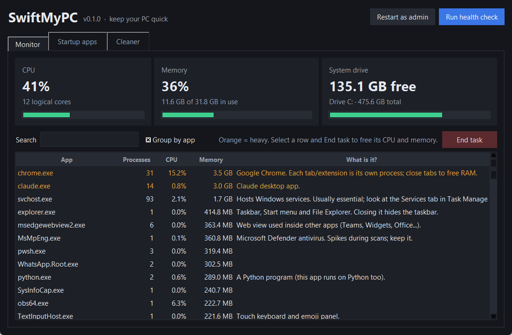
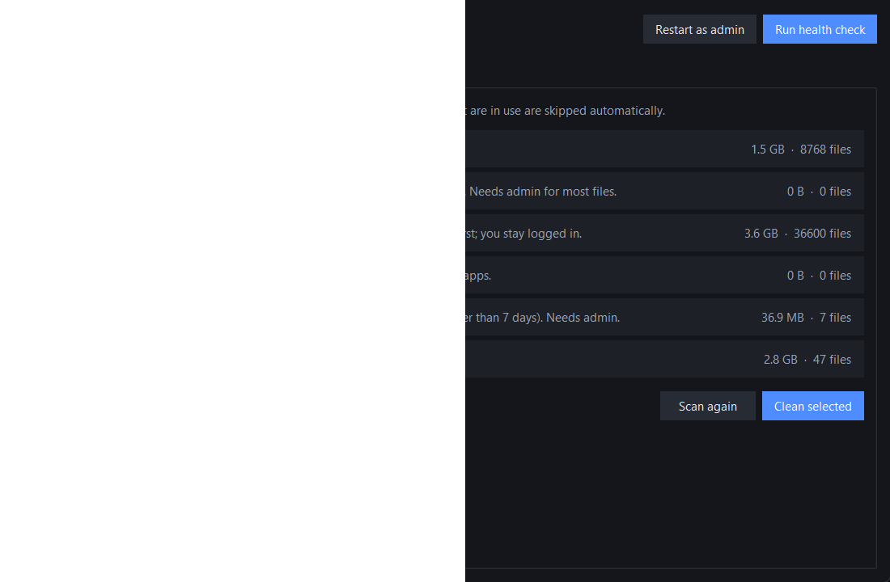
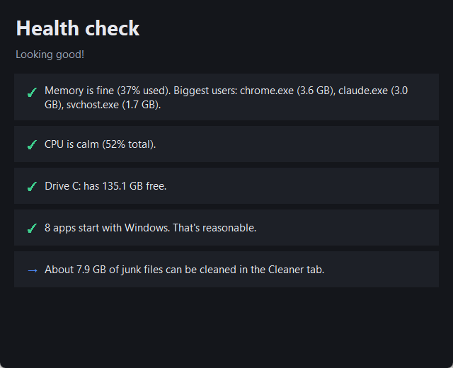

# SwiftMyPC

A small, honest Windows performance helper. It shows you **what** is slowing your PC down and lets you fix it, instead of running a fake "RAM booster".



## Features

- **Monitor**: live CPU, memory and disk usage, plus every running app grouped by name, with a plain-English "what is it?" column. Select an app and click **End task** to free its CPU and memory. Core Windows processes are protected so you can't crash your PC by accident.
- **Startup apps**: everything that launches when you sign in (registry and Startup folders). Disabling works exactly like Task Manager's: it's safe and fully reversible.
- **Cleaner**: frees disk space from temp files, browser caches (Chrome, Edge, Brave, Firefox), crash dumps, old Windows Update downloads and the Recycle Bin. You see sizes before anything is deleted. Files in use are skipped, recent temp files are kept, and links are never followed.
- **Health check**: one click gives you a short list of what is actually worth fixing.

| Cleaner | Health check |
|---|---|
|  |  |

## Why no "RAM cleaner"?

Windows deliberately uses spare RAM as a cache, because unused RAM is wasted RAM. Tools that "free" it make the number look nicer for a moment, then make apps slower while Windows reloads what it had cached. The real fix for high memory or CPU use is closing or removing the app responsible, or stopping it from starting with Windows. That's what SwiftMyPC helps you do.

## Run it

Requires Windows 10/11 and [Python 3.10+](https://www.python.org/downloads/).

```bat
git clone https://github.com/yassirabidy/SwiftMyPC.git
cd SwiftMyPC
run.bat
```

Or manually:

```bat
pip install -r requirements.txt
python -m swiftmypc
```

Some actions (Windows temp files, Windows Update cache, startup apps installed for all users, ending some system-level apps) need administrator rights. Use the **Restart as admin** button in the app.

## Project layout

```
swiftmypc/
  app.py       UI (tkinter)
  monitor.py   fast process sampling via NtQuerySystemInformation
  startup.py   startup apps (Run keys, Startup folders, StartupApproved flags)
  cleaner.py   junk scanning and cleaning
  explain.py   descriptions of common processes, protected list
```

## License

MIT
