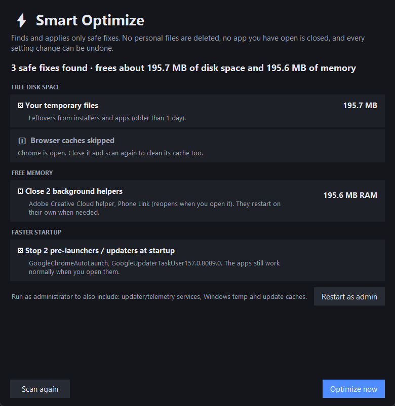

# SwiftMyPC

A small, honest Windows performance helper. It shows you **what** is slowing your PC down and lets you fix it, instead of running a fake "RAM booster".


## Features

- **⚡ Smart Optimize (one click)**: scans your PC and applies only the safe fixes in one go:
  - deletes junk files (temp files, caches, crash reports, old update files). Never your own files, never the Recycle Bin
  - clears browser caches only for browsers that are closed (you stay logged in)
  - closes known background helpers (updaters, Phone Link, Widgets, Game Bar) **only if they have no open window**. They restart on their own when needed
  - switches updater/telemetry services to **Manual** (never Disabled), so they still start whenever something needs them (admin)
  - stops browser pre-launchers and updaters from starting with Windows

  Service and startup changes are logged, and **Undo last changes** puts them back. With **Smart Optimize automatically once a day** (on by default, under Settings), SwiftMyPC cleans junk files and background helpers by itself when your PC isn't busy, and tells you what it freed. Browser caches are left out of the daily run, because wiping them every day would make browsing slower.
- **Monitor**: live CPU, memory and disk usage, a **10-minute CPU/memory history graph**, and every running app grouped by name with a plain-English "what is it?" column. Select an app and click **End task** to free its CPU and memory, or click **🧹 End unnecessary tasks** to close every known background helper (updaters, Phone Link, Widgets, Game Bar…) that has no open window, plus running updater services when you're admin. They restart by themselves when needed. Core Windows processes are protected so you can't crash your PC by accident.
- **Startup apps**: everything that launches when you sign in (registry and Startup folders). Disabling works exactly like Task Manager's: it's safe and fully reversible.
- **Services**: audits background services and highlights the ones that start with Windows but don't need to (updaters, telemetry, Xbox services, leftover VPNs...). Set them to Manual or Disabled in one click. Core Windows services are locked, and the original setting is saved so **Restore original** always works. Needs admin.
- **Cleaner**: frees disk space from temp files, browser caches (Chrome, Edge, Brave, Firefox), crash dumps, old Windows Update downloads and the Recycle Bin. You see sizes before anything is deleted. Files in use are skipped, recent temp files are kept, and links are never followed.
- **Health check**: one click gives you a short list of what is actually worth fixing.
- **Tray icon and alerts**: SwiftMyPC keeps running in the system tray (hover it for live CPU/memory) and notifies you when CPU stays above 85% for a minute, memory stays above 90%, one app hogs the CPU for 2 minutes, or your system drive gets nearly full. Alerts fire only for problems that last, then stay quiet for 15 minutes. Turn alerts, close-to-tray and **Start with Windows** on or off under **Settings**.

| Smart Optimize | Cleaner |
|---|---|
|  |  |

## Why no "RAM cleaner"?

Windows deliberately uses spare RAM as a cache, because unused RAM is wasted RAM. Tools that "free" it make the number look nicer for a moment, then make apps slower while Windows reloads what it had cached. The real fix for high memory or CPU use is closing or removing the app responsible, or stopping it from starting with Windows. That's what SwiftMyPC helps you do.

## Download

Grab **SwiftMyPC.exe** from the [latest release](https://github.com/yassirabidy/SwiftMyPC/releases/latest) and double-click it (Windows 10/11, 64-bit, no Python needed). It offers to **install itself** for your account, with no admin needed:

- one copy in `%LOCALAPPDATA%\Programs\SwiftMyPC`, with **Desktop** and **Start menu** shortcuts
- **updates itself**: it checks GitHub for new releases, verifies the download's SHA-256 and swaps it in. While it's running in the tray this happens automatically; otherwise you get an **Update now** banner. You can turn it off under Settings → Install updates automatically.
- can delete the downloaded file afterwards, so no old copies pile up
- listed in **Settings → Apps**, where you can uninstall it

Prefer not to install? Choose **Just run it once**, or start it with `--portable`. For scripts: `SwiftMyPC.exe --install` installs silently, and `--uninstall --quiet` removes it.

> Windows SmartScreen may say "Windows protected your PC" because the app isn't code-signed. Click **More info → Run anyway**. You can also build the .exe yourself from source (see below).

## Run from source

Requires Windows 10/11 and [Python 3.10+](https://www.python.org/downloads/).

```bat
git clone https://github.com/yassirabidy/SwiftMyPC.git
cd SwiftMyPC
run.bat
```

Or manually:

```bat
pip install -r requirements.txt
python -m swiftmypc
```

To build the .exe yourself, run `build.bat`. The result is in `dist\SwiftMyPC.exe`, together with `dist\SwiftMyPC.exe.sha256`. **Upload both files to every release**, because the updater refuses releases without a checksum.

Some actions (Windows temp files, Windows Update cache, startup apps installed for all users, ending some system-level apps) need administrator rights. Use the **Restart as admin** button in the app.

## Project layout

```
launcher.py    entry point for the .exe
build.bat      builds dist\SwiftMyPC.exe with PyInstaller
swiftmypc/
  app.py       UI (tkinter), single-instance handling
  charts.py    CPU/memory history graph
  optimizer.py Smart Optimize: safe-fix rules, run, undo
  installer.py per-user install, shortcuts, Apps entry, uninstall
  updater.py   GitHub release check, verified download, self-swap
  tray.py      tray icon and alert rules
  services.py  services audit (sc.exe, with restorable backup)
  settings.py  settings and Start with Windows
  monitor.py   fast process sampling via NtQuerySystemInformation
  startup.py   startup apps (Run keys, Startup folders, StartupApproved flags)
  cleaner.py   junk scanning and cleaning
  explain.py   descriptions of common processes, protected list
```

## License

MIT
